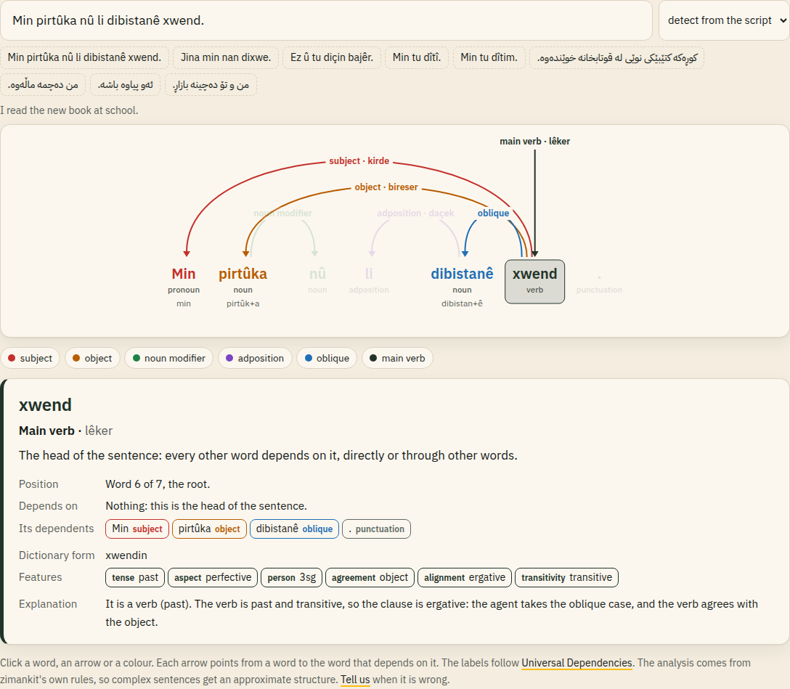

<p align="center">
  
</p>

<h1 align="center">zimankit · زمانکیت</h1>

<p align="center">
  <a href="https://0xdolan.github.io/zimankit/"><strong>Website</strong></a> ·
  <a href="https://0xdolan.github.io/zimankit/playground.html"><strong>Try it in your browser</strong></a> ·
  <a href="https://0xdolan.github.io/zimankit/guide.html">Guide</a> ·
  <a href="https://github.com/0xdolan/zimankit/releases/latest">Download</a> ·
  <a href="CHANGELOG.md">Changelog</a>
</p>

<p align="center">
  <a href="https://github.com/0xdolan/zimankit/actions/workflows/ci.yml"></a>
  <a href="https://github.com/0xdolan/zimankit/releases/latest"></a>
  
  <a href="LICENSE"></a>
</p>

**Kurdish language skills and wordlist builder** for Central Kurdish (Sorani, `ckb`, Arabic script) and Northern Kurdish (Kurmanji, `kmr`, Hawar Latin script).

*ziman* means "language" in both varieties.

| | |
|---|---|
| Skills | orthography · IPA / G2P · syllabification · transliteration · morphology · verb paradigms · split-ergativity checking · sentence structure · language identification |
| Data readers | `.mdx` dictionaries (in-process via `mdict-utils`) · `.zim` wiki dumps (`libzim`) · plain-text corpora |
| Kaggle dataset | `output/kaggle/` — one row per word, 59 flat columns (features, IPA, syllables, both scripts, definitions, frequency) as CSV · Parquet · SQLite + data card |
| Outputs | `clean_wordlist_ckb.csv` (329 190 forms) · `clean_wordlist_kmr.csv` (506 407 forms) · lemma tables · variant maps · grammar-rule JSON |
| Quality | 120+ tests incl. the ground-truth matrix and the tutorial drift check · IPA agrees 96.5 % (ckb) / 97.8 % (kmr) with reference transcriptions in the data |
| Dependencies | standard library only for the skills; `mdict-utils`, `libzim` for data ingestion |

<p align="center"><a href="https://0xdolan.github.io/zimankit/playground.html"></a></p>

## Install

zimankit needs Python 3.11 or newer and has no dependencies. Every file is on the [latest release](https://github.com/0xdolan/zimankit/releases/latest):

```bash
pip install "git+https://github.com/0xdolan/zimankit.git@v0.1.0"                 # pip, from GitHub
pip install https://github.com/0xdolan/zimankit/releases/download/v0.1.0/zimankit-0.1.0-py3-none-any.whl
sudo apt install ./python3-zimankit_0.1.0-1_all.deb                               # Debian, Ubuntu, Kali
```

The release also has the sdist, the full source as `.zip` and `.tar.gz`, and `SHA256SUMS`. The [guide](https://0xdolan.github.io/zimankit/guide.html) covers every command and the Python API.

## Quick start

```bash
uv venv --python 3.13 .venv && uv pip install --python .venv/bin/python mdict-utils libzim pytest
source .venv/bin/activate

python -m zimankit analyze کتێبەکەم jinekê
python -m zimankit ipa پیاوەکە کتێبەکەم jinekê dîtin      # pjaːwækæ k(ɯ)teːbækæm ʒɪnɛkeː diːtɯn
python -m zimankit conjugate کردن
echo "Min tu dîtim." | python -m zimankit ergativity       # agreement_ok: false
python -m zimankit parse "Min pirtûka nû li dibistanê xwend."   # head and relation of each word
python -m zimankit lid "Ma yew roje şima ra vat ke ziwanê ma zaf rind o"   # zza
python -m pytest -q
```

Build the wordlists from your own data:

```bash
cp config/sources.example.toml config/sources.local.toml   # set the paths (file is git-ignored)
./scripts/build_wordlists.sh

# Kaggle-ready dataset: flat columns, CSV + Parquet + SQLite + data card -> output/kaggle/
uv pip install --python .venv/bin/python pyarrow
python run_pipeline.py --stages export
```

## Documentation

Start at the **[documentation index](docs/00-index.md)**.

**Learning Kurdish?** The **[tutorials](docs/tutorials/README.md)** are two complete courses, [Sorani](docs/tutorials/ckb/README.md) and [Kurmanji](docs/tutorials/kmr/README.md), with 23 lessons each from the alphabet to ergativity, tagged 🟢 beginner / 🟡 intermediate / 🔴 advanced. Every conjugation, declension, IPA and transliteration table in them is generated by zimankit (`python scripts/gen_tutorials.py`), and a test fails if a lesson drifts from the code.

| part | chapters |
|---|---|
| Foundations | [1 Overview](docs/01-overview.md) · [2 Getting started](docs/02-getting-started.md) · [3 Data ingestion](docs/03-data-ingestion.md) · [4 Unicode](docs/04-unicode-normalization.md) · [5 Language ID](docs/05-language-identification.md) · [6 Tokenization](docs/06-tokenization.md) |
| Central Kurdish | [7 Orthography](docs/07-ckb-orthography.md) · [8 Phonology & IPA](docs/08-ckb-phonology-ipa.md) · [9 Morphology](docs/09-ckb-morphology.md) · [10 Verbs](docs/10-ckb-verbs.md) |
| Northern Kurdish | [11 Orthography](docs/11-kmr-orthography.md) · [12 Phonology & IPA](docs/12-kmr-phonology-ipa.md) · [13 Morphology](docs/13-kmr-morphology.md) · [14 Verbs & ergativity](docs/14-kmr-verbs-ergativity.md) |
| Cross-cutting | [15 Transliteration](docs/15-transliteration.md) · [16 Wordlist pipeline](docs/16-lexicon-pipeline.md) · [17 Regex cookbook](docs/17-regex-cookbook.md) · [18 Multi-language examples](docs/18-multi-language-examples.md) · [19 Testing](docs/19-testing.md) |
| Reference | [20 Glossary](docs/20-glossary.md) · [21 References](docs/21-references.md) |
| Sentences | [22 Sentence structure](docs/22-sentence-structure.md) |

Also: [agent skills](skills/README.md) · [cross-language examples](examples/README.md) · [engineering brief](PROMPT.md) · [contributing and releases](CONTRIBUTING.md) · [changelog](CHANGELOG.md) · [website source](site/).

## Layout

```
zimankit/
├── run_pipeline.py          lexicon → dictionaries → corpus → build → rules → export
├── config/                  pipeline.toml · sources.example.toml · sources.local.toml (ignored)
├── zimankit/
│   ├── tools/               mdx_extractor.py · zim_cleaner.py
│   ├── shared_utils/        normalizer · tokenizer · lid · phonology_core · text_helpers · unicode_tables · schema
│   ├── skills_ckb/          orthography · phonology_ipa · morphology · verbs · config.toml
│   ├── skills_kmr/          orthography · phonology_ipa · morphology · verbs · syntax · translit · config.toml
│   ├── lexicon/             wiki_lexicon · corpus · harvest · builder · export
│   ├── data/                authored reference tables (core verbs, function words)
│   ├── dependency.py        sentence structure: head and relation of each word
│   ├── rules.py             grammar_rules_<lang>.json exporter
│   └── cli.py               python -m zimankit …
├── output/{ckb,kmr}/        generated wordlists and reports
├── output/kaggle/           flat Kaggle dataset (export stage)
├── docs/                    developer chapters · tutorials/{ckb,kmr} (generated tables)
├── assets/brand/           logo, icons, social, ads, print, screenshots (scripts/make_brand.py)
├── site/                   website source (scripts/build_site.sh → _site/, deployed from main)
├── .github/workflows/      CI · release (on vX.Y.Z tags) · website
├── examples/  skills/  scripts/  tests/
```

## Output schema

`grapheme, lemma, pos, ipa, morph_meta, translit, frequency, sources, confidence` — see [chapter 16](docs/16-lexicon-pipeline.md#csv-schema).

```
کتێبەکەم,کتێب,NOUN,k(ɯ)teːbækæm,"{""definite"":""def"",""enclitic"":""1sg"",""number"":""sg"",""seg"":""کتێب+ەکە+م""}",kitêbekem,137,"encyclopedia,news,web",0.31
jinekê,jin,NOUN,ʒɪnɛkeː,"{""case"":""obl"",""definite"":""ind"",""gender"":""f"",""number"":""sg"",""seg"":""jin+ekê""}",ژنەکێ,530,"encyclopedia,lexicon-form,news",0.754
```

## The logo

<p align="center"></p>

The logo is a sign of **deq**, the traditional hand-poked tattoo of Kurdish women: the figure read as the **tree of life**, a symbol of fertility, growth and life force. Its circle stands for the cycle of life, its line and V shapes for a sprout or a tree, and its dots for protection against the evil eye. At its heart shines **Roj**, the 21-rayed sun of the flag of Kurdistan; *roj* / *ڕۆژ* means both "sun" and "day". Together they stand for Kurdish (*ziman*, "language") as a living language.

The full story, with the history and meaning of deq, sources, colours, usage, and every logo, icon, social, ad and print file, is in **[assets/brand/](assets/brand/README.md)**.

## Licence

The code is licensed under the [GNU General Public License v3.0 or later](LICENSE).

Generated data is licensed separately. The large generated files under `output/` are git-ignored (regenerate them with the pipeline; 300-row samples are kept). Wordlists derived from openly licensed sources may carry share-alike obligations when redistributed — check the licences of the data you configure. The published Kaggle dataset and the sample CSVs in `output/` are CC BY-SA 4.0.
