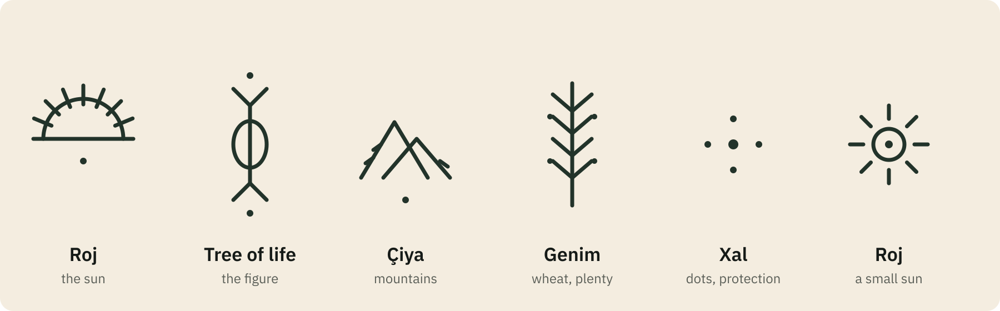
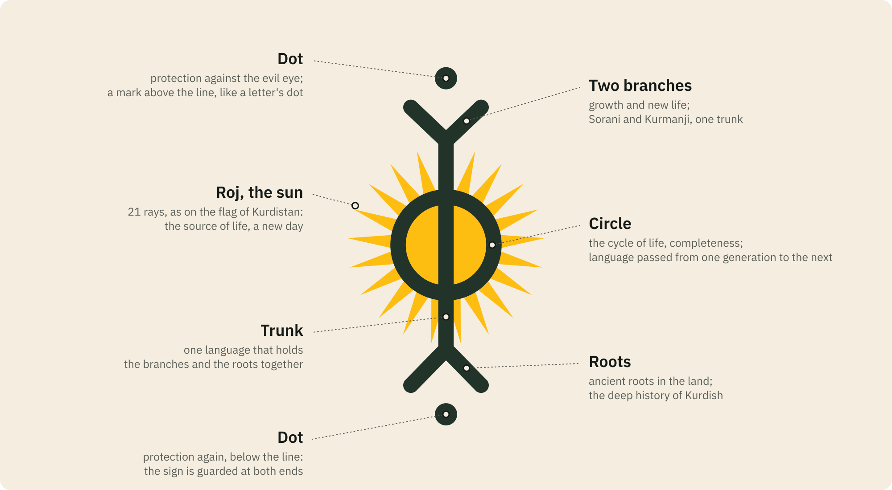

# The zimankit brand

<p align="center">
  
  &nbsp;&nbsp;
  
</p>

The zimankit logo is a **deq** sign, the figure of the **tree of life**, with **Roj**, the 21-rayed sun of the flag of Kurdistan, at its heart.

<p align="center"></p>

## Deq: the Kurdish tattoo

**Deq** (دەق; also called **xal**, خاڵ, "dot, mark") is the traditional hand-poked tattoo of the Kurds. It is worn above all by women, by Muslim Kurds and by **Yazidis** alike. Among Yazidi women it has carried even greater weight, as part of religious life. Neighbouring Arab, Assyrian, Armenian and Turkish communities of Upper Mesopotamia and Anatolia knew closely related practices, often under the name *daqq*.

**How it was made.** A woman of the community, often a mother tattooing her own children, drew the design on the skin. She pricked it with a sewing needle and rubbed in an ink of **soot mixed with breast milk**, traditionally the milk of a mother of a daughter, which was believed to make the mark permanent. Herbs or ox bile were sometimes added. Deq was worn on the face (forehead, chin, cheeks), the hands, the neck and the legs.

**What it meant.** A deq was never only decoration. Depending on the sign and where it was placed, it could:
- protect against the evil eye and against illness;
- carry a wish for health and fertility;
- mark beauty, or belonging to a family and a tribe;
- serve as a remedy (dots at the temples against migraine).

Most motifs come from the world around the wearer: the sun and the moon, stars, mountains, wheat and other crops, plants, combs, birds and gazelles. Every sign has a name, and its meaning can change from one community to another. A woman's deq has been described as a record of her life written on the skin.

**Decline and revival.** The practice faded in the second half of the twentieth century. Many people came to see it as old-fashioned or, for religious reasons, as forbidden, and henna often took its place. Today, deq is being revived. Kurdish tattoo artists rework the old signs, and young Kurds wear them, often as a vertical line of small signs down the spine or the arm, as an expression of Kurdish identity.

<p align="center"></p>

<sub>A few common deq signs, redrawn for this project. Names in Kurmanji: *roj* sun, *çiya* mountain, *genim* wheat, *xal* dot.</sub>

## The sign: the tree of life

The figure at the centre of the logo is one of the deq signs worn in these vertical lines. It is a dot, two branches raised like arms, a trunk passing through a circle, two roots, and a dot. It is read as the **tree of life**, a sacred plant that stands for fertility, growth and life force:

- **The circle**: the cycle of life, completeness and eternity.
- **The line and the V shapes**: a sprout, an ear of wheat or a tree. They carry the wish for a long life, for growth and for plenty.
- **The dots**: protective talismans against the evil eye (*nazar*) and harm.

## The sun: Roj

The sun at the heart of the figure is **Roj**, the emblem at the centre of the **flag of Kurdistan**, drawn with the exact path of the flag's official image. In Kurdish, *roj* (Kurmanji) and *ڕۆژ* (Sorani) mean both **the sun** and **the day**. On the flag, the yellow sun "represents the source of life and light of the people". Its **21 rays** hold religious and cultural importance in Yazidism, Yarsanism and Alevism, and 21 March is **Newroz**, the Kurdish new year. The sun is also a deq sign of its own: *Roj*, an arc with rays above a dot, worn on the forehead as the source of life.

## Why this logo for a language toolkit

*Ziman* means "language" in both Sorani and Kurmanji. The tree of life is a picture of a living language:

<p align="center"></p>

1. **Signs that carry meaning.** Deq is a writing on the skin, older than the alphabet, that says who you are and what protects you. zimankit is about written Kurdish: its letters, its sounds and its forms.
2. **Two branches, one trunk.** The raised branches are the two great written varieties, **Sorani** and **Kurmanji**. They grow from one trunk, one language, and zimankit serves both and transliterates between their scripts.
3. **Roots.** The roots reach down into the deep history of Kurdish. The wordlists are grown from it: dictionaries, encyclopedias, news and the spoken word.
4. **The circle and the sun.** Language is passed from one generation to the next, a cycle with no end. At its heart is Roj, the sun and the day: the light the language lives by.
5. **The dots.** The dots guard the sign at both ends. In Kurdish writing, dots and small marks are what tell letters apart (ی and ێ, ر and ڕ, ل and ڵ), and zimankit's normalizers and tests guard them in the same way.

## Colours

| name | hex | use |
|---|---|---|
| sun | `#FEBD11` | Roj, the sun of the flag of Kurdistan |
| ink | `#22332A` | the figure: the green-black of deq ink |
| sand | `#F4EDE0` | light ground: warm, like skin and undyed wool |
| night | `#13211C` | dark ground |
| pale | `#F3EEE2` | the figure on a dark ground |
| red · white · green | `#ED2024` · `#FFFFFF` · `#278E43` | the flag band at the foot of cards and banners |

Type: **IBM Plex Sans** for *zimankit* and Latin text, **IBM Plex Sans Arabic** for زمانکیت. In the files below the text is converted to paths, so the fonts are only needed to edit the sources.

## Usage

- Use the logo as it is. Do not recolour the sun, change the number of rays, rotate the figure or stretch it.
- Keep clear space around the mark of at least the diameter of its circle.
- On light grounds use `zimankit-mark` or `zimankit-logo`. On dark grounds use `zimankit-mark-on-dark` or `zimankit-logo-dark`. For single-colour printing, engraving or stamps use the mono marks.
- Use the bold small versions (`zimankit-logo-small`, `zimankit-mark-small`, the favicons) below 64 px. The full versions start at 64 px.

## Files

Everything is generated by [`scripts/make_brand.py`](../../scripts/make_brand.py) (`uv run python scripts/make_brand.py`; rendering needs Inkscape and ImageMagick). Do not edit the generated files by hand. Edit the script, or the live-text sources under `src/`, which the script rewrites.

```
assets/brand/
├── logo/
│   ├── svg/   zimankit-logo · -logo-dark · -logo-small (disc)
│   │          zimankit-mark · -mark-on-dark · -mark-small · -mark-mono-black · -mark-mono-white (no disc, transparent)
│   └── png/   zimankit-logo-{16…2048} · -logo-dark-{256,512,1024} · -mark*-{64…1024}
├── wordmark/  svg/ + png/ (@1x @2x @3x): horizontal and stacked, light and dark
├── icons/     favicon.ico · favicon.svg (follows the system dark mode) · favicon-{16,32,48}
│              apple-touch-icon · android-chrome-{192,512} · maskable-icon-512 · mstile-150
│              safari-pinned-tab.svg · site.webmanifest · app-store-1024 · play-store-512
├── social/    github-social-preview-1280x640 · og-image-1200x630 (+ light) · x-post-1200x675
│              x-header-1500x500 · linkedin-banner-1584x396 · facebook-cover-1640x624
│              youtube-banner-2560x1440 · instagram-post-1080x1080 · instagram-story-1080x1920
├── ads/       IAB units, light and dark, @1x @2x: leaderboard-728x90 · mobile-banner-320x50
│              large-mobile-banner-320x100 · billboard-970x250 · medium-rectangle-300x250
│              large-rectangle-336x280 · half-page-300x600 · wide-skyscraper-160x600
├── print/     poster-a4 (PDF + 300 dpi PNG) · sticker-75mm (PDF + 300 dpi PNG)
├── story/     zimankit-logo-construction · zimankit-logo-anatomy · deq-signs (@1x @2x)
├── kaggle/    kaggle-cover.svg (hand-made layout) · dataset-cover-image.png (560x280)
└── src/       the same compositions with live text
```

| need | file |
|---|---|
| README, docs | `logo/png/zimankit-logo-256.png`, `wordmark/png/zimankit-wordmark-horizontal-light.png` |
| GitHub repository social preview (Settings → Social preview) | `social/github-social-preview-1280x640.png` |
| website `<head>` | `icons/favicon.ico`, `icons/favicon.svg`, `icons/apple-touch-icon.png`, `icons/site.webmanifest`, `social/og-image-1200x630.png` |
| app stores | `icons/app-store-1024x1024.png` (App Store), `icons/play-store-512x512.png` (Google Play); both opaque, as the stores require |
| profile pictures | `logo/png/zimankit-logo-512.png` |
| slides, documents | `logo/svg/*.svg`, `wordmark/svg/*.svg` |
| print | `print/*.pdf` (vector), `logo/svg/zimankit-mark-mono-black.svg` for one-colour printing |
| Kaggle dataset cover | `kaggle/dataset-cover-image.png` (copied into `output/kaggle/` by the export stage) |

```html
<link rel="icon" href="/favicon.ico" sizes="48x48">
<link rel="icon" href="/favicon.svg" type="image/svg+xml">
<link rel="apple-touch-icon" href="/apple-touch-icon.png">
<link rel="manifest" href="/site.webmanifest">
<meta name="theme-color" content="#13211C">
<meta property="og:image" content="https://raw.githubusercontent.com/0xdolan/zimankit/main/assets/brand/social/og-image-1200x630.png">
```

## Sources

On deq:

- *Deq (tattoo)*, Wikipedia. <https://en.wikipedia.org/wiki/Deq_(tattoo)>
- "The deq tattooist: preserving the ink of a disappearing culture", Al Jazeera, 8 January 2023. <https://www.aljazeera.com/features/longform/2023/1/8/deq-the-tattooist-preserving-the-ink-of-a-disappearing-culture>
- "The last tattooed women of Kobane", National Geographic. <https://www.nationalgeographic.com/photography/article/the-last-tattooed-women-of-kobane>
- "Deq: a dying art among Turkey's Kurdish women", Daily Sabah, 13 January 2016. <https://www.dailysabah.com/feature/2016/01/13/deq-a-dying-art-among-turkeys-kurdish-women>
- "Skin as memory", Kurdistan Chronicle. <https://www.kurdistanchronicle.com/babat/4852>
- "Deq: Kurdish tattooing", NaTakallam. <https://natakallam.com/blog/deq-kurdish-tattooing/>
- "The evil eye and the needle: preserving cultural heritage", Institute of Development Studies. <https://www.ids.ac.uk/opinions/the-evil-eye-and-the-needle-preserving-cultural-heritage/>
- "Fatê Temel's desire to keep traditional tattooing (deq/xal) alive", SBS Kurdish. <https://www.sbs.com.au/language/kurdish/en/podcast-episode/fate-temels-desire-to-keep-traditional-tattooing-deq-xal-alive/n7e8v4lqw>
- "Partridge eyes and stars: traditional tattoos of Amazigh, Bedouin and Kurdish women", Middle East Eye.
- The motifs documented by the Kurdish anthropologist **Ahmet Yavuklu**.

On Roj and the flag:

- "The name and the logo", Roj. <https://0xdolan.github.io/roj/story.html>
- *Flag of Kurdistan*, Wikipedia. <https://en.wikipedia.org/wiki/Flag_of_Kurdistan>
- *Flag_of_Kurdistan.svg*, Wikimedia Commons, public domain: the sun's path. <https://commons.wikimedia.org/wiki/File:Flag_of_Kurdistan.svg>
- *Roj (stêrk)*, Kurdish Wikipedia. <https://ku.wikipedia.org/wiki/Roj_(st%C3%AArk)>
- *roj*, Wîkîferheng. <https://ku.wiktionary.org/wiki/roj>
- *ڕۆژ*, Wîkîferheng. <https://ku.wiktionary.org/wiki/%DA%95%DB%86%DA%98>

The readings of the tree-of-life sign above are the commonly given ones. Deq meanings were passed on orally and vary between regions and families, so no single reading is the only correct one.

## Licence

The logo and every file in this folder are licensed under GPL-3.0-or-later, like the rest of zimankit. The sun is the emblem of the flag of Kurdistan, which is in the public domain. The deq signs are traditional and belong to no one. They are redrawn here with respect, as a tribute to the women who wore them.
