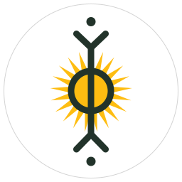
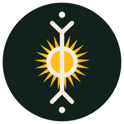
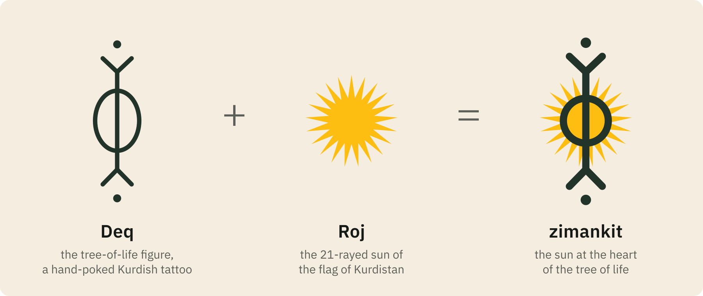
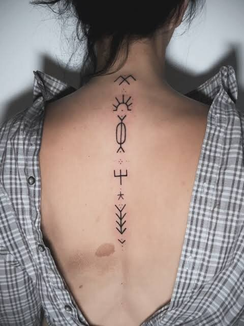
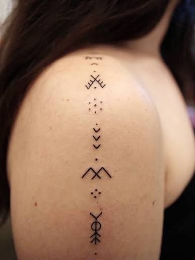
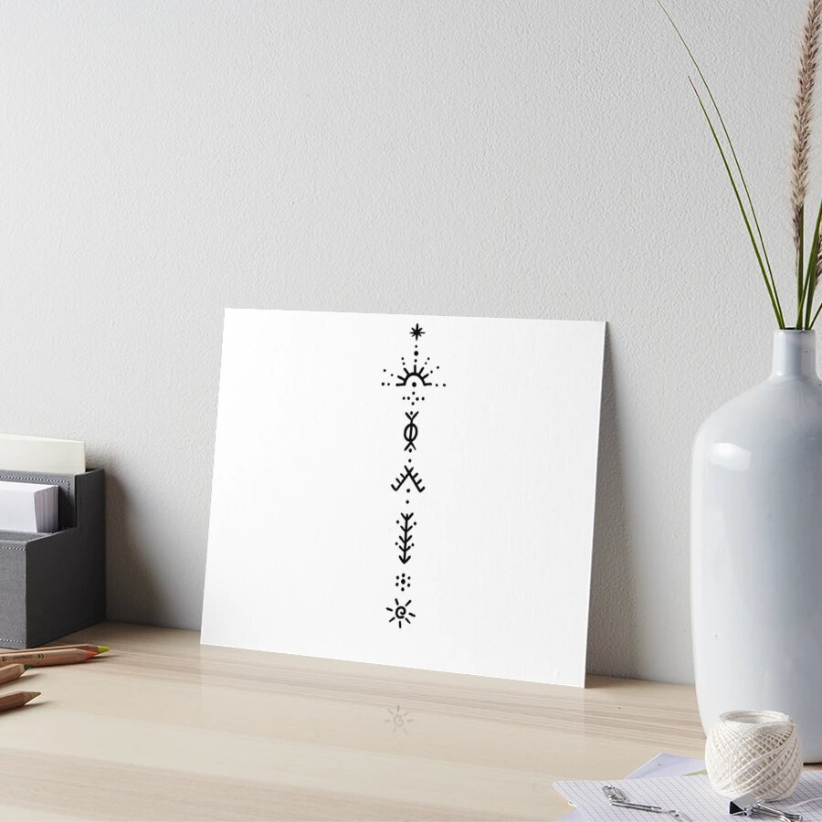
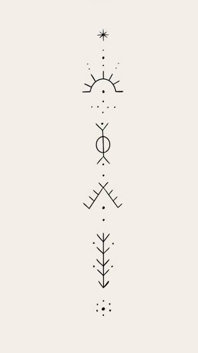
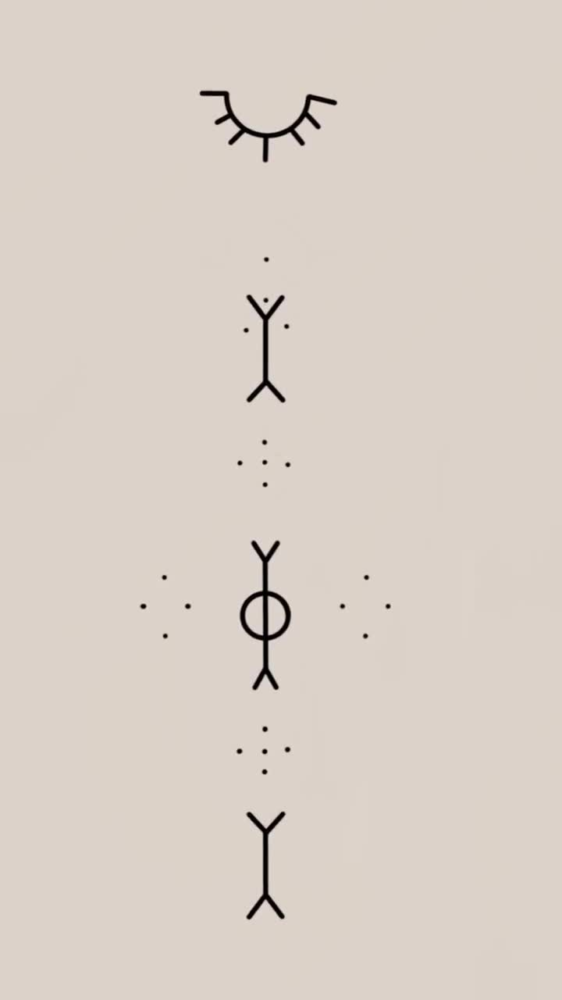
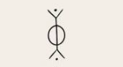

# The zimankit brand

<p align="center">
  
  &nbsp;&nbsp;
  
</p>

The zimankit logo is a **deq** sign, the figure of the **tree of life**, with **Roj**, the 21-rayed sun of the flag of Kurdistan, at its heart.

<p align="center"></p>

## Deq: the Kurdish tattoo

**Deq** (دەق; also called **xal**, خاڵ) is the traditional hand-poked tattoo of the Kurds, worn above all by women, on the face and hands. Among **Yazidi** women it has carried even greater weight, as part of religious life. Neighbouring Arab and Turkish communities knew a very similar practice, often called *daqq*.

**How it was made.** Women of the community did the tattooing, often a mother tattooing her own children. The design was drawn on the skin and pricked with a sewing needle. An ink of **soot mixed with breast milk** was spread over it, traditionally the milk of a mother of a daughter, which was believed to make the mark permanent. Herbs or ox bile were sometimes added.

**What it meant.** A deq was never only decoration. Depending on the sign and where it was placed, it could protect against evil and illness, carry a wish for health and fertility, or serve as a remedy (dots at the temples against migraine). Its motifs come mostly from nature: stars, the sun and the moon, plants and crops, tools, birds and deer. The meaning of a sign can change from one community to another.

**Decline and revival.** The practice largely stopped in the second half of the twentieth century. Many came to see it as old-fashioned or as forbidden by religion, and henna often took its place. Today, deq is being revived as an expression of Kurdish identity, often worn as a vertical line of small signs down the spine or the arm.

## Deq today

These images show how deq signs are worn and drawn today: as a vertical line of small signs down the back, the arm or on paper. The tree-of-life figure that the logo is built on appears in each of them.

<table>
<tr>
<td align="center" width="33%"><br><sub>A line of deq signs down the spine</sub></td>
<td align="center" width="33%"><br><sub>Deq signs down the arm</sub></td>
<td align="center" width="33%"><br><sub>A line of deq signs as an art print</sub></td>
</tr>
<tr>
<td align="center"><br><sub>A drawn line of deq signs</sub></td>
<td align="center"><br><sub>The tree-of-life figure, between dots, in a line of signs</sub></td>
<td align="center"><br><sub>The tree-of-life sign: the source of the logo</sub></td>
</tr>
</table>

<sub>Photos and drawings shared by the project author as examples of deq worn today; their original sources are not known. If you are the author of one of them and want it credited or removed, please open an issue.</sub>

## The sign: the tree of life

The figure in the logo is a deq sign. It is a dot, a V shape opening upwards, a line passing through a circle, a V shape opening downwards, and a dot. It is read as the **tree of life** (or a sacred plant), a symbol of fertility, productivity and life force:

- **The circle**: the cycle of life, completeness and eternity.
- **The line and the V shapes**: together they suggest a sprout, wheat or a tree, a wish for a long life, growth and fertility.
- **The dots**: protective talismans against the evil eye (*nazar*) and negative energy.

## The sun: Roj

The sun at the heart of the figure is **Roj**, the emblem at the centre of the **flag of Kurdistan**, drawn with the exact path of the flag's official image. In Kurdish, *roj* (Kurmanji) and *ڕۆژ* (Sorani) mean both **the sun** and **the day**. On the flag, the yellow sun "represents the source of life and light of the people", and its **21 rays** hold religious and cultural importance in Yazidism, Yarsanism and Alevism.

## Why this logo for zimankit

*Ziman* means "language" in both Sorani and Kurmanji. The logo puts the sun of the flag at the heart of a deq sign of life and growth: Kurdish, a living language, carried forward. Deq is also a kind of writing, signs passed from hand to hand that carry meaning, and zimankit is about written Kurdish.

## Colours

| name | hex | use |
|---|---|---|
| sun | `#FEBD11` | Roj, the sun of the flag of Kurdistan |
| ink | `#22332A` | the figure: the green-black of deq ink |
| sand | `#F4EDE0` | light ground: warm, like skin and undyed wool |
| night | `#13211C` | dark ground |
| pale | `#F3EEE2` | the figure on a dark ground |
| red · white · green | `#ED2024` · `#FFFFFF` · `#278E43` | the flag band at the foot of cards and banners |

Type: **IBM Plex Sans** for *zimankit* and Latin text, **IBM Plex Sans Arabic** for زمانکیت. In the files below the text is converted to paths, so the fonts are only needed to edit the sources.

## Usage

- Use the logo as it is. Do not recolour the sun, change the number of rays, rotate the figure or stretch it.
- Keep clear space around the mark of at least the diameter of its circle.
- On light grounds use `zimankit-mark` or `zimankit-logo`. On dark grounds use `zimankit-mark-on-dark` or `zimankit-logo-dark`. For single-colour printing, engraving or stamps use the mono marks.
- Use the bold small versions (`zimankit-logo-small`, `zimankit-mark-small`, the favicons) below 64 px. The full versions start at 64 px.

## Files

Everything is generated by [`scripts/make_brand.py`](../../scripts/make_brand.py) (`uv run python scripts/make_brand.py`; rendering needs Inkscape and ImageMagick). Do not edit the generated files by hand. Edit the script, or the live-text sources under `src/`, which the script rewrites.

```
assets/brand/
├── logo/
│   ├── svg/   zimankit-logo · -logo-dark · -logo-small (disc)
│   │          zimankit-mark · -mark-on-dark · -mark-small · -mark-mono-black · -mark-mono-white (no disc, transparent)
│   └── png/   zimankit-logo-{16…2048} · -logo-dark-{256,512,1024} · -mark*-{64…1024}
├── wordmark/  svg/ + png/ (@1x @2x @3x): horizontal and stacked, light and dark
├── icons/     favicon.ico · favicon.svg (follows the system dark mode) · favicon-{16,32,48}
│              apple-touch-icon · android-chrome-{192,512} · maskable-icon-512 · mstile-150
│              safari-pinned-tab.svg · site.webmanifest · app-store-1024 · play-store-512
├── social/    github-social-preview-1280x640 · og-image-1200x630 (+ light) · x-post-1200x675
│              x-header-1500x500 · linkedin-banner-1584x396 · facebook-cover-1640x624
│              youtube-banner-2560x1440 · instagram-post-1080x1080 · instagram-story-1080x1920
├── ads/       IAB units, light and dark, @1x @2x: leaderboard-728x90 · mobile-banner-320x50
│              large-mobile-banner-320x100 · billboard-970x250 · medium-rectangle-300x250
│              large-rectangle-336x280 · half-page-300x600 · wide-skyscraper-160x600
├── print/     poster-a4 (PDF + 300 dpi PNG) · sticker-75mm (PDF + 300 dpi PNG)
├── story/     zimankit-logo-construction (@1x @2x) · deq/ (deq photos and drawings, see "Deq today")
├── screenshots/ website-home · website-home-dark · website-home-mobile · website-playground
├── kaggle/    kaggle-cover.svg (hand-made layout) · dataset-cover-image.png (560x280)
└── src/       the same compositions with live text
```

| need | file |
|---|---|
| README, docs | `logo/png/zimankit-logo-256.png`, `wordmark/png/zimankit-wordmark-horizontal-light.png` |
| GitHub repository social preview (Settings → Social preview) | `social/github-social-preview-1280x640.png` |
| website `<head>` | `icons/favicon.ico`, `icons/favicon.svg`, `icons/apple-touch-icon.png`, `icons/site.webmanifest`, `social/og-image-1200x630.png` |
| app stores | `icons/app-store-1024x1024.png` (App Store), `icons/play-store-512x512.png` (Google Play); both opaque, as the stores require |
| profile pictures | `logo/png/zimankit-logo-512.png` |
| slides, documents | `logo/svg/*.svg`, `wordmark/svg/*.svg` |
| print | `print/*.pdf` (vector), `logo/svg/zimankit-mark-mono-black.svg` for one-colour printing |
| Kaggle dataset cover | `kaggle/dataset-cover-image.png` (copied into `output/kaggle/` by the export stage) |

```html
<link rel="icon" href="/favicon.ico" sizes="48x48">
<link rel="icon" href="/favicon.svg" type="image/svg+xml">
<link rel="apple-touch-icon" href="/apple-touch-icon.png">
<link rel="manifest" href="/site.webmanifest">
<meta name="theme-color" content="#13211C">
<meta property="og:image" content="https://raw.githubusercontent.com/0xdolan/zimankit/main/assets/brand/social/og-image-1200x630.png">
```

## Sources

On deq:

- *Deq (tattoo)*, Wikipedia. <https://en.wikipedia.org/wiki/Deq_(tattoo)>
- "The deq tattooist: preserving the ink of a disappearing culture", Al Jazeera, 8 January 2023. <https://www.aljazeera.com/features/longform/2023/1/8/deq-the-tattooist-preserving-the-ink-of-a-disappearing-culture>
- "The last tattooed women of Kobane", National Geographic. <https://www.nationalgeographic.com/photography/article/the-last-tattooed-women-of-kobane>
- "Deq: a dying art among Turkey's Kurdish women", Daily Sabah, 13 January 2016. <https://www.dailysabah.com/feature/2016/01/13/deq-a-dying-art-among-turkeys-kurdish-women>
- "Skin as memory", Kurdistan Chronicle. <https://www.kurdistanchronicle.com/babat/4852>
- "Deq: Kurdish tattooing", NaTakallam. <https://natakallam.com/blog/deq-kurdish-tattooing/>
- "The evil eye and the needle: preserving cultural heritage", Institute of Development Studies. <https://www.ids.ac.uk/opinions/the-evil-eye-and-the-needle-preserving-cultural-heritage/>
- "Fatê Temel's desire to keep traditional tattooing (deq/xal) alive", SBS Kurdish. <https://www.sbs.com.au/language/kurdish/en/podcast-episode/fate-temels-desire-to-keep-traditional-tattooing-deq-xal-alive/n7e8v4lqw>

On Roj and the flag:

- "The name and the logo", Roj. <https://0xdolan.github.io/roj/story.html>
- *Flag of Kurdistan*, Wikipedia. <https://en.wikipedia.org/wiki/Flag_of_Kurdistan>
- *Flag_of_Kurdistan.svg*, Wikimedia Commons, public domain: the sun's path. <https://commons.wikimedia.org/wiki/File:Flag_of_Kurdistan.svg>
- *Roj (stêrk)*, Kurdish Wikipedia. <https://ku.wikipedia.org/wiki/Roj_(st%C3%AArk)>
- *roj*, Wîkîferheng. <https://ku.wiktionary.org/wiki/roj>
- *ڕۆژ*, Wîkîferheng. <https://ku.wiktionary.org/wiki/%DA%95%DB%86%DA%98>

The tree-of-life reading of the sign was supplied by the project author. Deq meanings were passed on orally and vary between regions and families, so no single reading of a sign is the only correct one.

## Licence

The logo and every file in this folder are licensed under GPL-3.0-or-later, like the rest of zimankit. The sun is the emblem of the flag of Kurdistan, which is in the public domain. The deq sign is traditional and belongs to no one. It is redrawn here with respect, as a tribute to the women who wore it.
